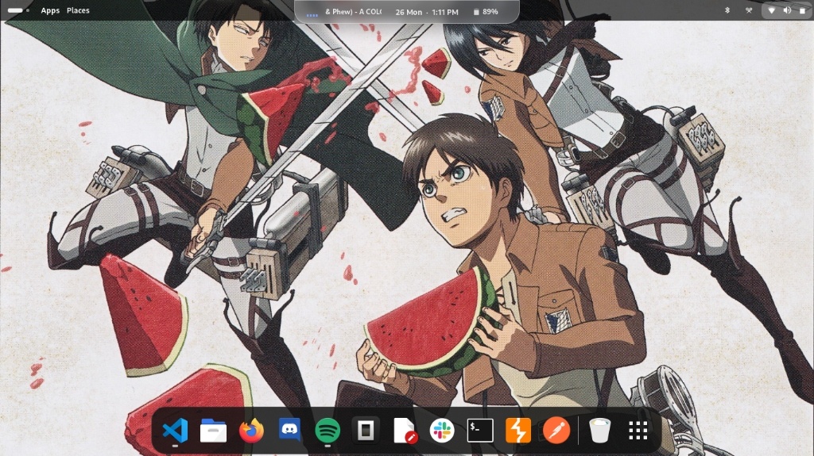
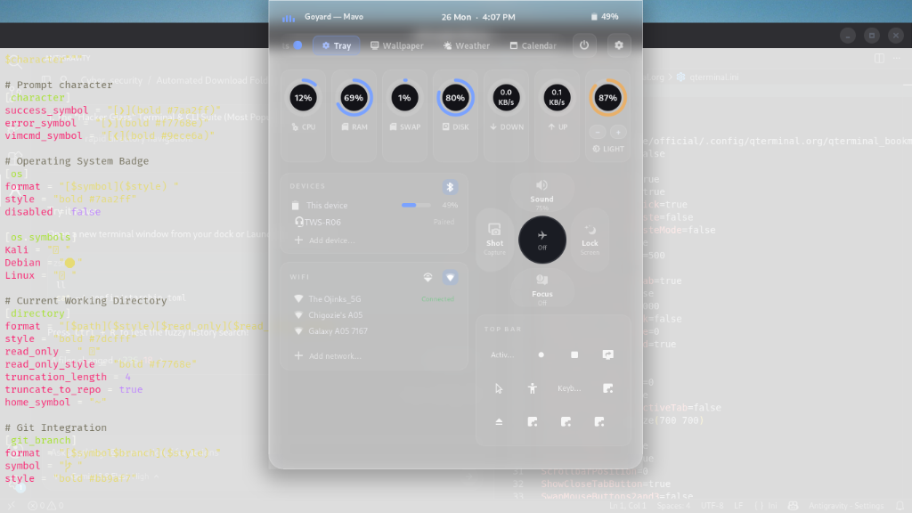
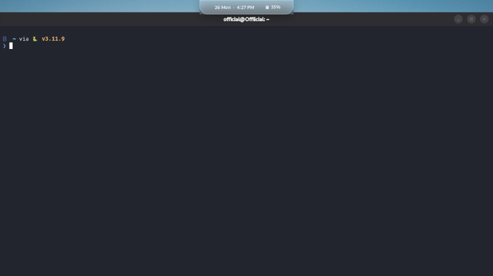

# 🧊 BlackIce

> **The Frosted Glass & Dynamic Island Desktop Suite for Kali Linux & GNOME**

[](https://www.kali.org)
[](https://www.gnome.org)
[](LICENSE)
[](#)

```
    ____  __            __   ____          
   / __ )/ /___ _____  / /__/  _/_______     
  / __  / / __ `/ __ \/ //_// // ___/ _ \    
 / /_/ / / /_/ / /_/ / ,< _/ // /__/  __/    
/_____/_/\__,_/\____/_/|_/___/\___/\___/     
```

<p align="center">
  
</p>

**BlackIce** transforms Kali Linux into a hyper-polished, fluid, frosted glass workstation inspired by macOS design and tactical cyber security workflows. It integrates an intelligent auto-hiding **Dynamic Island**, a floating **Frosted Glass Dock**, a curated **3-Page Tactical Pentest App Grid**, and a high-contrast **Obsidian Terminal Suite**.

<p align="center">
  
  
</p>

---

## ✨ Features at a Glance

### 🏝️ Intelligent Dynamic Island
* **Smart Idle Auto-Hide**: Automatically tucks above the bezel when idle to save screen real estate.
* **Active Activity Reveal**: Instantly slides down into view when music is playing, a notification arrives, or privacy indicators (mic/camera) activate.
* **Top-Edge Hover Reveal**: Push your cursor to the top center edge to reveal the island at any time.
* **Tactile Hardware Controls**: Clickable and scrollable rotary dials for volume and screen brightness (+/- 5% steps).
* **Screenshot Safe**: Collapses instantly on <kbd>Esc</kbd>, <kbd>PrintScreen</kbd>, or clicking the tray screenshot tile to prevent capture obstruction.

### 🫧 Frosted Glass Dock (Dash to Dock)
* Floating centered frosted pill with translucent glass borders and subtle backdrop reflections.
* Compact 40px icon scale with running-indicator neon glow dots.
* Pinned macOS-style Launchpad on the left; Trash cleanly hidden from the dock.

### 📱 3-Page Curated Tactical Launchpad
* **Page 0 (Daily Drivers)**: Browser, Code, Terminal, Spotify, Discord, Burp Suite, Wireshark, Postman.
* **Page 1 (The Pentest Pipeline)**: All 17 Kali tool categories organized in MITRE ATT&CK tactical sequence (*Recon → Initial Access → Execution → Persistence → Privilege Escalation → Lateral Movement → Exfiltration*).
* **Page 2 (System Utilities)**: Software center, disk utility, text editors, document viewers.
* Full-screen Dual-Kawase frosted wallpaper blur with search pill.

### 💻 "Hacker Glass" Terminal & CLI Suite
* **Deep Obsidian Theme**: `#23252e` charcoal background with 100% solid contrast (no washed-out text bleed).
* **Starship Prompt**: Includes the official Kali Linux Dragon badge (``), git branch status, and active python/language runtimes.
* **Fastfetch System Banner**: Instant telemetry and clean ASCII branding on terminal startup.
* **Patched Typography**: Pre-bundled with `FiraCode Nerd Font Mono` for crisp icons and ligatures.
* **Modern CLI Toolchain**: Aliases for `eza` (modern tree `ls`), `bat` (syntax-highlighted `cat`), and `fzf` fuzzy history search (<kbd>Ctrl</kbd> + <kbd>R</kbd>).

---

## 🚀 Quick Start (1-Click Install)

Clone the repository and run the automated installer:

```bash
git clone https://github.com/your-username/BlackIce.git
cd BlackIce
chmod +x install.sh
./install.sh
```

Restart your terminal session or run:
```bash
source ~/.zshrc
```

*(If visual extensions don't load immediately, simply log out and back in to refresh GNOME Shell).*

---

## ⌨️ Shortcuts Reference

| Shortcut | Action |
| :--- | :--- |
| <kbd>Esc</kbd> | Instantly collapse expanded Dynamic Island |
| **Top Edge Hover** | Reveal tucked Dynamic Island |
| <kbd>Ctrl</kbd> + <kbd>Alt</kbd> + <kbd>T</kbd> | Launch BlackIce QTerminal |
| <kbd>Ctrl</kbd> + <kbd>Shift</kbd> + <kbd>T</kbd> | New Terminal Tab |
| <kbd>Ctrl</kbd> + <kbd>Shift</kbd> + <kbd>N</kbd> | New Terminal Window |
| <kbd>Ctrl</kbd> + <kbd>Shift</kbd> + <kbd>M</kbd> | Toggle Terminal Menu Bar |
| <kbd>Ctrl</kbd> + <kbd>R</kbd> | FZF Fuzzy Command History Search |
| <kbd>PrintScreen</kbd> | Screen capture (auto-collapses Dynamic Island) |

---

## 🗂️ Project Structure

```
BlackIce/
├── install.sh                  # Interactive 1-click installer
├── uninstall.sh                # Revert script
├── README.md                   # Documentation & showcase
├── LICENSE                     # MIT License
├── assets/                     # Showcase screenshots & media
├── configs/
│   ├── starship/               # Starship CLI configuration (starship.toml)
│   ├── fastfetch/              # Fastfetch system info banner profile
│   ├── qterminal/              # Solid obsidian palette & settings
│   ├── notchnux/               # Dynamic Island configuration template
│   └── zsh/                    # ZSH modern toolchain snippet
├── extensions/
│   ├── notchnux@adityasah.programs/  # Patched Dynamic Island extension
│   └── blur-my-shell@aunetx/         # Dual-Kawase blur extension
├── fonts/
│   └── FiraCodeNerdFont/       # Complete patched Nerd Font family
├── themes/
│   └── TST - Semi Transparent/ # Tuned GNOME Shell frosted glass theme
├── wallpapers/
│   ├── gallery/                # 24-hour dynamic day/night wallpaper sequence
│   └── xml/                    # GNOME background cycle definitions
└── dconf/
    └── blackice-gnome.dconf    # Full desktop dconf dump (Dock, App Grid, Blur)
```

---

## 🔄 Reverting / Uninstallation

If you ever wish to return to standard GNOME defaults:

```bash
cd BlackIce
./uninstall.sh
```

---

## 📄 License

This project is licensed under the [MIT License](LICENSE).
Feel free to fork, customize, and share!
